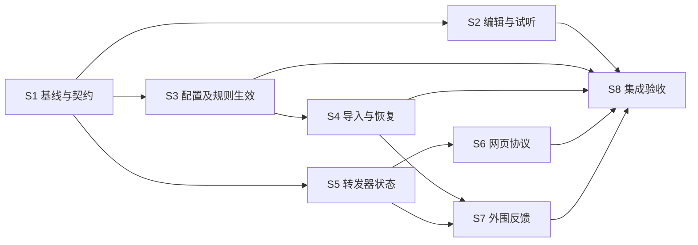

# TTS Server 交互修缮 Plan

日期：2026-10-11。状态：主要修缮已实施；S8 真机完整套件有 7 项失败，整体尚未达到完成条件。
方法：ECC `click-path-audit` 全应用分区追踪 + `blueprint` 分步规划与独立审查。

## 目标与范围

让用户从点击到完成操作走通：导航、配置/分组、五种 TTS 编辑器、试听、规则/插件、导入导出、备份恢复、转发器启停、内嵌网页、设置、文件选择、日志与通知。优先消除崩溃、错误成功提示、意外修改其他配置和运行状态不一致，再改善错误恢复与反馈。

审计阶段只新增 plan/审计文档，未修改业务代码；后续实施情况记于本文末尾。MiMo TTS 是外部引擎兼容性验收依赖，不扩大成另一个应用的整体重构。原始导出目录没有 Git checkout，因此实施采用直接模式；GitHub 版本以仓库中的 `tts-server/` 子目录为目标。

## 证据与覆盖

详见四份审计附件，每条发现有源码路径、行号、调用顺序、修复建议与验证条件：

- [Android 转发器](audit-forwarder-2026-10-11.md)
- [配置列表与编辑器](audit-edit-list-2026-10-11.md)
- [规则、导入及备份](audit-rules-data-2026-10-11.md)
- [网页与外围入口](audit-web-misc-2026-10-11.md)

证据等级：**确认**表示当前源码可直接证明缺陷；**风险**表示需要设备/并发/失败注入验证；两者均不代表已经真机复现。附件按入口区分已追踪、仅扫描和未验证，未逐个点击所有控件。Microsoft 网页来自外部 Go 依赖，当前未获取其内容，不能声称全量审计通过。

工作区 `TTS Server/.codegraph` 已存在；优先 CodeGraph。工具标记源码漂移或未索引的 HTML 才直接读取，不自行建立/更新索引。已有测试集中于请求参数、路由、快照、MiMo 绑定等，不能证明下列 UI 链路完好。本次没有执行构建/测试；`adb devices -l` 失败，daemon 无法启动。设备恢复是最终真机验收前置条件。

## 首批应修的问题

| 优先级 | 问题 | 用户影响 | 执行步骤 |
|---|---|---|---|
| P1 | 采样率、同步端口直接 `toInt` | 清空或输入溢出数值后崩溃 | S2 / S7 |
| P1 | 本地/MiMo 试听失败或空结果未结束等待 | 一直加载且没有错误解释 | S2 |
| P2 | 单选分组取消先关闭全部配置（跨组历史/导入状态） | 用户操作一个分组影响其他分组 | S3 |
| P1 | 替换规则广播发送但未注册接收 | 排序/总开关改了，运行服务没更新 | S3 |
| P1 | 未知导入类型的异常越过 catch | 导入未知文本时异常上抛 | S4 |
| P1 | 恢复失败后依然显示完成 | 用户误以为数据已恢复 | S4 |
| P1 | 连续恢复复用旧目录；同版本插件/规则不覆盖 | 混入上一包数据或恢复静默无效 | S4 |
| P1 | ZIP 解压缺少规范路径边界检查 | 恢复包可写出临时目录 | S4 |
| P1 | 文件选择器 fallback 再次调用系统选择器 | 无法选文件，反复递归甚至崩溃 | S4 |
| P1 | 转发器关闭/日志广播同名、首页状态未初始化 | 开关错误、日志串页、端口可误改 | S5 |
| P1 | 网页默认 voice 与 Go 校验、pitch 范围不一致 | 默认试听或部分参数请求被拒绝 | S6 |
| P1 | 网页文本、阅读链接多层拼接未正确编码 | 特殊字符文本截断、参数串入 URL | S6 |
| P2 | 空白试听仍传空串；BGM 简化页清空全局试听文本 | 点击试听与显示内容不一致 | S2 |
| P2 | 改端口后 WebView reload 旧地址、JS 弹窗取消不完成 | 网页打不开或操作后挂起 | S5 |
| P2 | 通知固定到系统转发器、热启动不处理目标页 | 点击通知进错页面 | S7 |

其他确证问题与待验证项以附件为准；同一根因合并修复，不能仅为增加数量拆分发现。运行时发布问题必须按实际消费链验证，不把所有 DAO 元数据写入都判为断链。

## 共享状态约束

1. 编辑器输入草稿 → 校验 → 生成有效配置/请求 → 保存或试听；校验失败不得提前落库或改 enabled。
2. Room current rows → `RuntimeConfigWriter` / `RuntimeConfigWriteCoordinator` 事务 → APPLIED generation → `SystemTtsService.notifyUpdateConfig` → manager 实际应用。保存成功与服务生效需分别确认；先覆盖实际参与运行的写路径，保留现有请求快照与路由契约。
3. 试听结果为成功、失败、取消之一，所有路径释放等待态、播放器与引擎；旧请求回调不得覆盖新请求 UI。
4. 转发器真实状态为 Idle/Starting/Running/Stopping/Failed；UI、Tile、通知不得仅根据点击推测 Running。Go start 是阻塞调用，不能把 ready 广播移到返回之后。
5. 导入文件/URL/剪贴板互斥；取消不修改数据。备份恢复失败不能提示完成；多表写入必须明确事务/部分恢复语义。

## 依赖顺序

S1 后 S2、S3、S5 可按文件所有权并行；S3→S4 串行处理 DAO/发布/导入，S5→S6 串行处理服务与 Web/Go。S5/S6 由同一 AAR 集成负责人维护唯一库更新队列，禁止同时覆盖 app/libs；S5 如增加 ready 回调，必须在该步重建并集成兼容 AAR，验证 Android 消费者后交给 S6，S6 再集成网页协议版本。复杂状态/事务设计与最终审查用最强可用模型，其余步骤用默认模型，不依赖特定供应商型号。

## 执行步骤（每步一个可审查改动）

### S1 — 建立复现基线和发布/协议契约

上下文：Android `app/libs/*.aar` 是实际消费库；Go 源码不一定与已有 AAR 一致。已有路由、请求快照和 MiMo 测试必须保留。

- 记录 Java/SDK/NDK/Go/gomobile 可用版本、Gradle flavor、AAR 哈希/来源；保存原库备份。
- 从 res/menu、layout、preferences、navigation 与监听器生成入口矩阵：入口、handler、读写状态、DAO/服务/API、完成/失败/取消反馈、覆盖等级。
- 为后续核心缺陷建立最小失败用例，先验证确实失败；不在此步预写所有实现镜像测试。
- 对齐 voice 缺省、pitch/rate 单位、HTTP 错误、listener ready、配置 generation 语义。
- 核对 Go listen host 与 Android 展示/复制地址，以及 token Header 与网页/阅读客户端支持；LAN 和鉴权先明确支持范围，未经验证不直接打开远程监听或鉴权。

验证：`./gradlew.bat :app:testAppDebugUnitTest`，Go 目录 `go test ./...`；先修复环境问题，不用历史报告替代本次结果。
退出：基线结果、入口矩阵与契约落文档，确定源码/AAR差异；缺失工具明确记录。
回退：只增测试/文档，不改发布库。

### S2 — 编辑器校验与试听完成态

上下文：`BaseTtsEditActivity`、`LocalTtsEditActivity`/`LocalTtsViewModel`、`LocalTtsParamsEditView`、`HttpTtsEditActivity`、BGM 简化编辑页。

- 修正默认试听文本的计算顺序；没有输入控件时保留共享测试文本。
- 采样率/数字使用安全解析与引擎能力校验；显示字段错误，禁止无效请求/保存。
- 统一试听成功/失败/空音频/取消的结果，`try/finally` 收敛等待与按钮状态；明确 false/null 的含义，不吞错误。
- 处理连续试听、切引擎、离开页面、旧回调；沿用现有 MiMo request snapshot 与 engine switch policy。

验证：单测参数/结果状态；仪器测试空文本、清空/溢出采样率、MiMo 失败、无音频、重复点击/退出再进入。
退出：每次操作都结束等待且反馈正确；无效输入不崩溃不落库。
回退：独立回退编辑器改动，不修改现有持久化 schema。

### S3 — 配置/分组/规则真实生效

上下文：列表/分组 handler、`SystemTtsDao`、替换规则管理、`SystemTtsService` receiver 与 runtime writer。

- 单选组“关闭当前组”仅修改该组；仅启用另一个组时执行互斥。
- 删除组及其条目采用事务；排序/删除/启停/导入后的实际运行配置由发布入口协调。
- 修正替换规则专用广播注册或统一到配置发布事件，并验证 manager 重新装载 replacer。
- 对每个运行时写入口验证 generation/服务应用，处理失败反馈；禁止保存 UI 成功但服务仍读旧配置。
- 规则/插件删除与引用关系依附件处理，避免孤立配置。

验证：Room 事务与发布失败测试；播放中改配置/规则，再次请求确认使用新版本；进程重启后恢复 committed 配置。现有 CanonicalSpeechContracts/RouteDeclarationResolver/快照回归。
退出：分组操作不影响无关组；规则改动可观察生效，事务失败不留下半完成数据。
回退：回退 handler/协调改动；若后续需 schema 变更，单独拆步并备份，不静默加迁移。

### S4 — 导入、文件选择、备份恢复闭环

上下文：`BaseImportConfigBottomSheetFragment`、各具体 importer、`FilePickerActivity`、`BackupRestoreFragment/ViewModel` 与运行时写入口。

- 文件/URL/剪贴板按当前选择读取；切换来源清理或隔离缓存 tag。
- 未知/空/损坏 JSON 在同一错误边界处理；预览、确认与提交分开，取消不写。
- 修复系统 picker 失败时 fallback 到内置 picker、通配 MIME 匹配与取消结果。
- 恢复返回成功/失败/取消/部分恢复的明确结果；只有提交成功显示恢复完成，事务/回滚语义有测试。
- 每次恢复使用独立临时目录并 finally 清理；按本次包清单读取。恢复覆盖策略与安装版本更新策略分开，同版本变量/脚本也能按确认的恢复契约覆盖。
- ZIP 条目解压前规范化路径并检查目标边界；约束展开大小/数量。非法条目中止且不写出临时目录。
- 导出失败不把错误字符串当配置导出；直链上传/网络超时具备错误恢复与防重。
- 保存空输出流报告失败；URI 权限仅按实际授权 flags 获取。来源缓存和文件 provider 故障属于待复现项，验证后再提交修复。

验证：来源 A→B 切换、空剪贴板、未知类型、损坏压缩包、连续恢复包 A/B、同版本变量/脚本恢复、ZIP ../ 和绝对路径、系统 picker 不可用、text/* 与 audio/*、取消、写入失败、导出再导入 round-trip。
退出：错误不崩溃、不误报成功；用户选中的来源与最终导入内容一致。
回退：独立回退导入/恢复逻辑；保留原始备份，不能为验证清除用户数据。

### S5 — 转发器生命周期、网页宿主状态

上下文：`AbsForwarderService`、两种 Home/Host/Web Fragment、广播和 Tile。

- 首页创建/恢复实时渲染服务状态；消除 sys 状态/port 快照。
- 区分两服务广播；真实 listener ready 后进入 Running，失败/停止同步所有入口。
- 先核对 ready 是否已有可用回调；若新增 Go API，本步负责兼容扩展→重建 AAR→更新 Android 消费者→记录哈希，不能留到 S6 才提供 S5 必需接口。
- 启动期间防重、处理取消与重启；端口校验后提交，日志和通知使用实际监听端口。
- 地址变化使用 loadUrl 最新地址；网页 stopped/loading/error/retry 状态与刷新收尾。
- JS alert/confirm 所有退出路径完成 result；token 修改显示需要重启/应用状态。
- 停止/销毁时核对 instance、LocalTtsEngineHelper 和播放器清理；共享引擎的取消/并发请求先故障注入再决定 request ID/串行隔离方案。

验证：两服务同时运行并分别关闭；端口占用/改端口、慢启动、启动中停止、旋转/返回页面、Tile 失败、网页弹窗返回键取消；新增 Go 接口时执行 go test 和 Android assemble/unit tests，使用本步 AAR实测消费者。
退出：开关、端口锁定、网页和 Tile 与实际服务器一致，无串日志/旧地址。
回退：保持服务和 Go ready 接口兼容；若需要 API 扩展，先加兼容接口，再切消费者，允许回退旧 AAR。

### S6 — Web/Go 参数与链接协议

上下文：系统转发器 HTML、`sys_tts_server/server.go` 与测试；Microsoft 页来自 go.mod 固定依赖，须先取得该版本源码或运行包验证。

- 明确默认 voice 策略：UI 选默认音色/始终传值，或后端按契约支持缺省，二者一致。
- 统一 pitch/rate 范围与默认值，保留现有 LocalTTS/外部引擎转换契约。
- 修复首次 localStorage 空值、布尔值恢复/持久化、事件误引用；网络失败/取消结束 loading。
- 引擎选择请求按 generation/AbortController 隔离，旧响应不能覆盖当前音色；空引擎/音色目录禁用相关动作并提供重试。
- 验证离线 CDN、Blob 回收/play Promise 失败与请求停止语义；仅对确认缺陷做相应修缮，不把暂停播放当作取消 HTTP。
- 使用 URLSearchParams/正确层级编码处理文本、engine/voice 和 Legado 的 src，验证嵌套 URL round-trip。
- 重建 Go 库并按项目构建路径更新 Android 消费的 AAR；记录哈希及版本。禁止只改 Go 源码便宣称 APK 已修复。
- 构建工作目录为 `TTS Server/tts-server-lib`；按已有 README 执行 `gomobile bind -v -target="android/arm,android/arm64" -androidapi=19`，再将生成库集成到 `app/libs/tts_server_lib.aar`。先固定/记录实际 Go、gomobile、NDK 版本，不使用 `@latest`；若验收设备为 x86/x86_64，必须补对应 target 并验证 APK ABI，不能直接沿用 arm 命令。更新前保留 S5 库备份与哈希。

验证：`go test ./...`；浏览器测试默认试听、pitch 边界、首次访问、刷新、引擎响应逆序、空 engines/voices、特殊字符 `& + # ? 中文`、生成阅读链接再解析；APK 对同样输入验证。
退出：HTML→HTTP→引擎参数一致；源码/AAR/APK 可追溯。Microsoft 页未取得内容时保持未验证状态。
回退：HTML与Go接口配套回退，恢复原 AAR；不能让新 UI 配旧协议。

### S7 — 导航、设置与操作反馈补齐

上下文：MainActivity 冷/热启动、转发器通知、ScriptEditor 同步设置、插件变量/直链设置/日志等外围入口。

- 通知注入正确页面与独立 PendingIntent identity；onNewIntent 处理目标导航。
- 同步 enabled 与 port 先整体校验再保存；设置摘要、取消、失败语义依附件统一。
- 明确插件“预览并保存”的持久化语义，修正零参数 DAO update；远程同步设置后核对当前服务是否应用并提供生效反馈。
- 收口重复加载/保存、离页协程、未保存编辑提醒等待复现问题；先复现再改，避免猜测性改动。

验证：两个通知冷/热启动；端口非法/取消不变更 enabled；设置重进/旋转；日志清空/复制和帮助返回。
退出：入口到达正确页面，用户可分辨保存完成、重启生效、失败与取消。
回退：仅回退外围导航/反馈，无数据迁移。

### S8 — 全链路验收和独立审查

上下文：S1 入口矩阵与 S2–S7 已修问题；真实设备、AAR 与 APK版本一致。

- 跑 `./gradlew.bat :app:testAppDebugUnitTest :app:assembleAppDebug :app:lintAppDebug`；具备设备后 `./gradlew.bat :app:connectedAppDebugAndroidTest`；Go `go test ./...`。
- 真机顺序：新建配置→试听→保存→启用→Android TTS 调用；规则修改→热更新→再次朗读；导出→导入→备份→恢复；两转发器→网页试听→复制阅读链接→停止→改端口重启。
- 加失败矩阵：无引擎、MiMo 不可用、无音色、空音频、超时、无效 JSON、文件选择器不可用、端口占用、取消/旋转/进后台、快速重复点击。
- 独立代码/交互审查；报告当前结果与未覆盖条目，关键路径不能有 P1 未解决，风险项必须转为验证结论或明确后续范围。

退出：覆盖矩阵所有项有结果，关键路径完成/失败/取消均可恢复；没有“测试未执行却通过”的条目。
回退：按步骤逆序回退受影响模块，保留用户数据和备份；源码与 AAR 成对恢复。

## 计划变更与完成判定

独立审查结果：无 Critical；Major 为 WEB-06 实施/验收漏项，以及 S3/S4、S5/S6 依赖/AAR 所有权未闭合。当前版本已补请求隔离与空目录验证、串行依赖、唯一 AAR 集成负责人及 S5 必需接口的同一步集成。其余建议（同步端口归属、插件预览保存、固定构建工具与风险验收归属）已纳入。

每步记录状态（待开始/进行中/已验证/阻塞）、实际改动、执行命令/结果、剩余风险。新增发现须附证据后插入或拆步，更新依赖图；无关问题另建 backlog。已存在修复经复核可跳过并注明证据，不重复重构。任何运行时协议或事务语义调整先修改 S1 契约。

计划交付与修复完成分开：本文交付只表示扫描与规划完成；只有 S8 达到退出条件才能称交互修缮完成。

## 实施记录（2026-10-11）

整体状态：S1–S7 的选定修缮已实施并通过本地验证；S8 的单测、APK、lint 和范围内 6 项真机回归通过，但完整真机测试为 16/23 通过、7 项失败。外部 MiMo 引擎链路仍有失败，因此本计划保持“验收未完成”，不得报告所有交互均已通过。

### S1 — 基线与契约

- 已记录 Go 1.27.2、JDK 17、Android SDK `D:\code\AndroidSdk`、NDK 21.4.7075529 与固定版本 gomobile `v0.0.0-20220722155234-aaac322e2105`；README 已更新构建命令。
- 主 Go 模块 `go test ./...`、`go build ./...` 通过；vendored Microsoft server 的聚焦测试 `go test ./server` 通过。
- 原 `github.com/jing332/tts-server-go` 固定版本 `v0.0.0-20230130020836-aed022548060` 已复制到 `tts-server-lib/third_party/tts-server-go`，以本地 `replace` 构建，补丁清单见 [LOCAL_PATCHES.md](../tts-server-lib/third_party/tts-server-go/LOCAL_PATCHES.md)。
- vendored 模块全量测试含上游联网测试：Creation 接口返回 401，Edge WebSocket 握手返回 403；这不是本地 server 单测结果。离线首次运行还缺一个未缓存的 CLI 测试依赖。

### S2–S4 — 编辑试听、运行配置、导入恢复

- 已加入采样率、端口及测试文本策略；本地/MiMo 试听统一收尾失败、空结果、取消与等待状态，避免空输入覆盖共享文本。
- 分组启停/删除、替换规则组操作采用事务并触发运行时刷新；恢复同版本插件/规则时覆盖数据但保留数据库行，ZIP 限制路径穿越与展开规模，文件选择器回退、取消和 MIME 通配符已修。
- 备份恢复与单选组/替换规则新增 6 项 instrumentation 回归在 Lenovo L71091（Android 13）上全部通过；Android 单测也通过。

### S5–S7 — 转发器、网页协议与外围反馈

- 已修正两个转发器的广播/首页状态/通知目标和端口应用；JS 弹窗取消、WebView 地址更新、插件预览保存、配置导入/导出失败提示已处理。
- 系统 TTS 与 Microsoft Web 页面均按查询参数层级编码；Go 默认 voice、pitch 范围和 Legado JSON/Token Header 契约已对齐。Microsoft Edge/Azure/Creation 三页已修复空音色/列表失败状态、SSML XML 转义、依赖音色选项清理、试听 AudioContext 收尾、剪贴板和 Legado 深链编码。
- 浏览器验证：Edge 页面实际加载 322 个音色、选中中文默认音色，特殊字符名称在导入链接中保持完整；Azure/Creation 在 file URL 阻止接口请求时正确显示失败态并禁用试听/导入。Chrome DevTools 隔离浏览器不能连接本机临时 HTTP mock，因此这两页的成功 API 响应和真实试听仍未做浏览器回归。Node VM 对三页脚本语法、XML 转义、编码与深链 round-trip 通过。离线 CDN 未验证。
- 旧版阅读应用导入协议通过 GET 获取配置，无法在抓取源 URL 时附加 Header，所以生成的**一次性导入源 URL 仍含 token 查询参数**；导入后的 TTS 请求将 token 放在 `Token` Header。改变此限制需要阅读端支持请求 Header 或引入服务端状态方案。

### S8 — 验收

- 通过：`:app:testAppDebugUnitTest`、`:app:assembleAppDebug`、`:app:lintAppDebug`、`:app:compileAppDebugAndroidTestKotlin`、主 Go 模块测试与构建、vendored `go test ./server`。
- 范围内真机回归：新增 6 项 Room 分组/恢复测试 6/6 通过。
- 完整 `:app:connectedAppDebugAndroidTest`：23 项中 7 项失败：`DirectUploadEngineTest.catBox`（外部上传失败）、`DirectUploadEngineTest.testJS`（返回类型转换异常）、`HttpTtsUrlTest.test`（测试 URL JSON 转义错误）、`OkHttpTest.postMultiPart`（外站超时）、`RhinoEngineTest.script`（脚本返回类型转换异常），以及 `MimoRestartCompatibilityTest` 两项（MiMo 朗读返回 `ERROR_SYNTHESIS`；强停 MiMo 后 TTS 客户端 20 秒未收到终态回调）。这些失败不能算通过；MiMo 两项仍是外部引擎兼容风险。
- 本地最终 AAR `app/libs/tts_server_lib.aar` 的 SHA-256 为 `A945A70846E434942879AA38AE2D9E0DDE4E1D5BBF0237AB887CEE6841CD03C0`，27,031,491 bytes，包含 `armeabi-v7a`、`arm64-v8a`、`x86`、`x86_64`。目标仓库的 `app/.gitignore` 忽略此构建产物，其 GitHub Actions workflows 会从 Go 源码重建并上传 AAR，因此不强制提交二进制。
- 本地最终 APK `app/build/outputs/apk/app/debug/TTS-Server-v0.9_debug.apk` 的 SHA-256 为 `B7149D38476B5713C09DEF574B6664FD7A81F5762280A0F8B30B7BD7B962B87B`，51,881,751 bytes，已确认包含四种 ABI；APK 属于未跟踪构建产物，不提交。
- GitHub 推送目标为 `ll7836176-cell/mimo-tts` 的 `fix/tts-server-interaction-repair` 分支，修缮内容位于 `tts-server/` 子目录。

退出条件尚未满足：完整真机套件中的 MiMo 兼容失败和其他失败需分别修复或通过基线/范围说明处理；Azure/Creation 的正常 HTTP 成功路径、两个转发器同时启停、通知冷热启动、真实阅读应用导入和离线 CDN 仍未验收。
